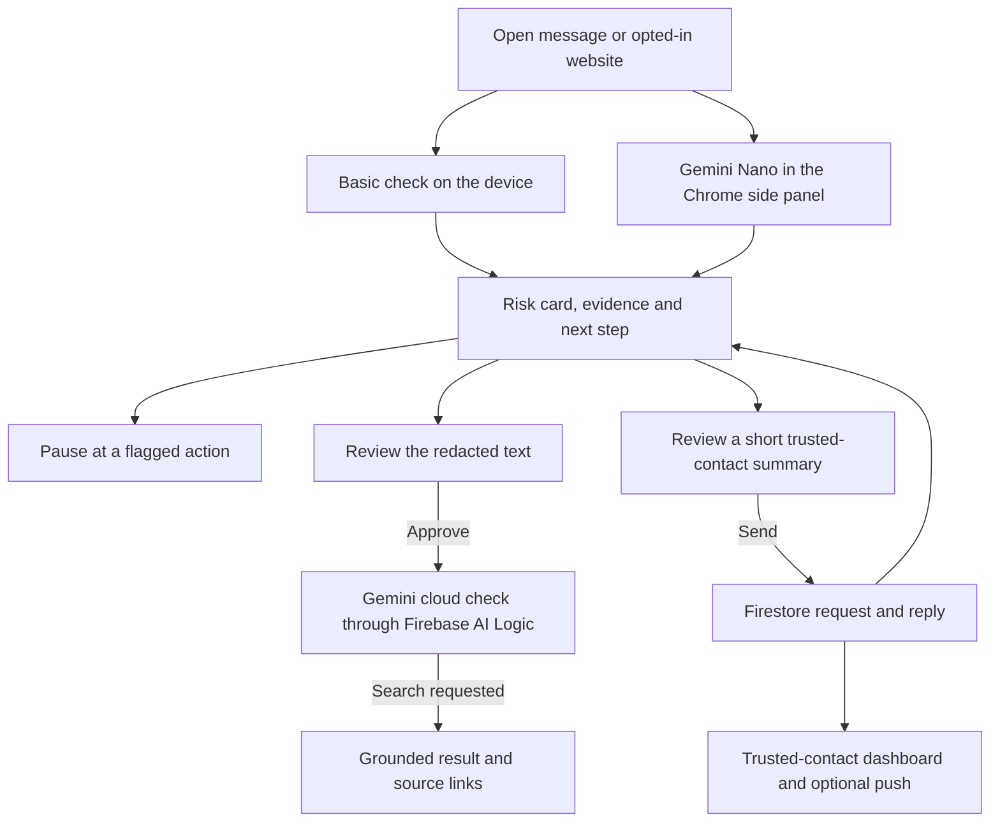

# Bifocal

Bifocal helps older adults spot scam warning signs in messages and pause before taking a risky action. It uses Firebase AI Logic to check messages in Chrome, with a cloud check available after the user reviews and approves a redacted copy.

## How hybrid is used

| Task | Firebase AI Logic mode | SDK call |
| --- | --- | --- |
| Check an open Gmail message, a received text, or an opted-in website | `ONLY_ON_DEVICE` when Gemini Nano is ready. A basic check runs locally first. | [Chrome screening](https://github.com/AdityaChauhanX07/bifocal/blob/d7ba6212707cafd856f93f0be3b3f8cfd29c4edc/apps/extension/lib/private-model.ts#L26) |
| Check pasted text privately | `ONLY_ON_DEVICE`. Use Gemini Nano when it is ready, with a basic local check as the fallback. | [Web screening](https://github.com/AdityaChauhanX07/bifocal/blob/4cff8f61933524e82fff0d9473a927eaa441eaff/apps/web/src/screening-model.ts#L98) |
| Check a built-in fictional example | `PREFER_ON_DEVICE` when cloud checks are configured and the browser is online. The SDK can use a cloud model if needed. | [Web screening](https://github.com/AdityaChauhanX07/bifocal/blob/4cff8f61933524e82fff0d9473a927eaa441eaff/apps/web/src/screening-model.ts#L98) |
| Recheck a redacted message after approval | `ONLY_IN_CLOUD`. Send the exact preview the user approved. | [Approval handler](https://github.com/AdityaChauhanX07/bifocal/blob/4cff8f61933524e82fff0d9473a927eaa441eaff/apps/web/src/try/TryPage.tsx#L77) · [Web screening](https://github.com/AdityaChauhanX07/bifocal/blob/4cff8f61933524e82fff0d9473a927eaa441eaff/apps/web/src/screening-model.ts#L98) |
| Look up corroborating guidance after approval | `ONLY_IN_CLOUD` with Google Search grounding. | [Chrome search](https://github.com/AdityaChauhanX07/bifocal/blob/d7ba6212707cafd856f93f0be3b3f8cfd29c4edc/apps/extension/lib/cloud-model.ts#L61) |
| Explain a warning from its tier and tactic codes | `PREFER_IN_CLOUD` when signed in and online. Use local AI or a built-in guide when needed. | [Chrome explanation](https://github.com/AdityaChauhanX07/bifocal/blob/d7ba6212707cafd856f93f0be3b3f8cfd29c4edc/apps/extension/lib/cloud-model.ts#L85) |
| Lead with the clearest warning in a trusted-contact request | `ONLY_ON_DEVICE`. The model can select a warning code, which Bifocal turns into a prewritten sentence. | [Contact summary](https://github.com/AdityaChauhanX07/bifocal/blob/4cff8f61933524e82fff0d9473a927eaa441eaff/apps/extension/trusted-contact/summary.ts#L55) |

The result shows whether it used on-device AI, cloud AI, or the basic check. Install the Chrome extension for Gmail, Google Messages and Pause. The separate Chrome side-panel smoke test returned a valid on-device result while offline. [Extension setup](apps/extension/README.md) · [Offline smoke test](tools/chrome-smoke/README.md)

## Architecture



Chrome Enhanced Protection warns about dangerous sites, downloads and extensions. Bifocal adds explanations and next steps inside Gmail and Google Messages, a pause at supported actions, and a way to ask one person for a second opinion. [Chrome Safe Browsing](https://support.google.com/chrome/answer/9890866?hl=en)

## Try Bifocal locally

The hosted demo includes fictional samples, a practice checkout, and the local-only Chrome ZIP. [Try Bifocal](https://bifocal-buildhybridai2026.web.app/try) · [Chrome ZIP](https://bifocal-buildhybridai2026.web.app/downloads/bifocal-chrome.zip)

The gift-card sample returned **Checked with Google Gemini** in a fresh browser profile with Nano unavailable. The live request used anonymous Auth and reCAPTCHA Enterprise App Check on Spark. A separate pasted message used the basic local check.

From the repository root with Node.js 24.12 or later, build the signed-out demo and serve it with the Firebase Hosting emulator. The build bundles the Chrome ZIP with the demo.

```sh
npm ci
npm run build:judge-demo
npx firebase-tools@15.37.0 emulators:start --only hosting --project demo-bifocal
```

Open `http://127.0.0.1:5000/try` in desktop Chrome. Select a fictional example and click **Check sample**. To check your own text, choose **Paste a message** and **Check privately**. [Judge walkthrough](docs/judge-demo.md) · [Web app setup and cloud configuration](apps/web/README.md#try-bifocal)

## Privacy and App Check

The private check keeps pasted text on the device. When the optional cloud check is enabled, the user can review the redacted text before sending it. Review matters because the redaction rules cover common patterns and can miss identifying details. The web app uses Firebase anonymous sign-in and reCAPTCHA Enterprise App Check for cloud screening. The extension's token endpoint checks a Google sign-in and the configured extension origin. [Cloud setup](apps/web/README.md#enable-hosted-cloud-checks) · [Extension token endpoint](functions/README.md)

## Held-out evaluation

Gemini Nano returned valid screenings for 61 of 65 fictional messages. It flagged 29 of 31 scams with valid results and marked 1 of 30 legitimate messages with valid results as high risk. Median latency for valid rows was 2.70 seconds. Four screenings failed validation, and the two cloud paths still need a live run. [Results and error analysis](eval/results/on-device.md) · [Evaluation setup](eval/README.md) · [User-testing protocol](docs/user-testing.md)

## Limits

Google Messages screening looks for incoming text in the open conversation. Pause checks supported actions in the top-level page, so an embedded payment widget can escape that check. A basic local check remains available when Chrome cannot run Gemini Nano. The side panel labels the method it used. [Extension behavior](apps/extension/README.md)

## Shared screening

Run `npm ci`, `npm test`, and `npm run typecheck` with Node.js 24.12 or later.

Use `screenSchema` from `@bifocal/core` as the Firebase response schema and `systemPrompt` as the system instruction. Pass the model's JSON and the exact text it screened to `parseScreening`. If parsing returns `null`, discard that model response. Use `nextSteps` to display the action the model selected.

Use `redactText` with the extracted sender address and any known profile or trusted-contact details. Use the returned text as the consent preview and pass that same text to cloud screening after approval. The redaction rules cover common US address and number formats.
