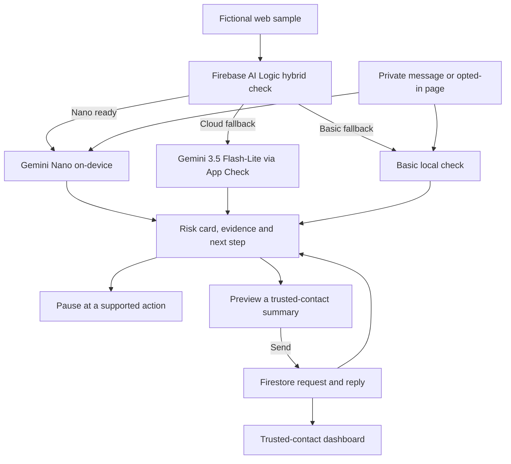

# Bifocal

Bifocal helps older adults spot scam warning signs, pause before taking a risky action, and ask someone they trust for a second opinion. The Chrome extension checks open Gmail messages, incoming Google Messages texts, and websites where the user enables checks. Each warning points to the text that triggered it and gives a plain-language next step.

[Try Bifocal](https://bifocal-buildhybridai2026.web.app/try) · [Download Chrome 0.1.3](https://bifocal-buildhybridai2026.web.app/downloads/bifocal-chrome.zip) · [Judge walkthrough](docs/judge-demo.md)

## Try the demo

1. On **Try Bifocal**, check **A text from a new number** and **A pickup reminder**. Compare the warning and the suggested next step. The result shows how the message was checked.
2. Extract the Chrome ZIP. Go to `chrome://extensions`, enable **Developer mode**, and choose **Load unpacked**. Select the folder with `manifest.json`.
3. Open the [practice checkout](https://bifocal-buildhybridai2026.web.app/demo/checkout.html). In Bifocal’s side panel, open **Settings** and enable website checks. Click **Buy gift card** to see Pause. An early release keeps the dialog open. After holding for five seconds, click **Buy gift card** again to finish the simulated checkout.

The hosted demo opens without an account and uses fictional examples. Trusted contacts use a separate Spark extension build and the [signed-in dashboard](https://bifocal-buildhybridai2026.web.app/dashboard). The sender previews a short summary, the contact replies, and the reply appears on the original risk card. [Trusted-contact setup](docs/release-checklist.md#verify-trusted-contacts-on-spark)

## How Bifocal uses Firebase AI Logic

| Action | Inference | SDK call |
| --- | --- | --- |
| Check a Gmail message, incoming text, or opted-in website | `ONLY_ON_DEVICE` when Gemini Nano is ready. Basic rules provide a local result while the model runs. | [Chrome screening](https://github.com/AdityaChauhanX07/bifocal/blob/36ea9f07b259644b5cd9a50055ad9dd5a76f8e65/apps/extension/lib/private-model.ts#L17-L30) |
| Check pasted text | `ONLY_ON_DEVICE` with Nano, with a basic local fallback. | [Private web check](https://github.com/AdityaChauhanX07/bifocal/blob/36ea9f07b259644b5cd9a50055ad9dd5a76f8e65/apps/web/src/screening-model.ts#L90-L101) |
| Check a built-in fictional example | `PREFER_ON_DEVICE`. The hosted Spark project uses Gemini 3.5 Flash-Lite when the local model is unavailable. | [Hybrid model configuration](https://github.com/AdityaChauhanX07/bifocal/blob/36ea9f07b259644b5cd9a50055ad9dd5a76f8e65/apps/web/src/screening-model.ts#L61-L64) · [Model call](https://github.com/AdityaChauhanX07/bifocal/blob/36ea9f07b259644b5cd9a50055ad9dd5a76f8e65/apps/web/src/screening-model.ts#L77-L101) |
| Prepare a trusted-contact summary | `ONLY_ON_DEVICE`. The model can choose which warning to lead with, and Bifocal turns it into a prewritten sentence. | [Contact summary](https://github.com/AdityaChauhanX07/bifocal/blob/36ea9f07b259644b5cd9a50055ad9dd5a76f8e65/apps/extension/trusted-contact/summary.ts#L32-L63) |

The hosted cloud sample path uses anonymous Firebase Auth and reCAPTCHA Enterprise App Check. Private checks keep message text on the device. An optional deployment can offer a redacted cloud check after the user reviews and approves the exact preview. See the developer setup for that deployment and for Google Search grounding and push notifications. [Web cloud setup](apps/web/README.md#enable-hosted-cloud-checks) · [Extension cloud setup](apps/extension/README.md#enable-signed-in-features)



## Held-out evaluation

The benchmark used 65 fictional messages, including 32 scams. Gemini Nano returned 61 valid screenings and flagged 29 of the 31 scams with valid results. Both cloud runs returned 65 valid screenings after retries and flagged all 32 scams. The original-text cloud run marked one legitimate message as high risk. The redacted run had zero false highs. [Results and error analysis](eval/results/cloud.md) · [Evaluation setup](eval/README.md)

## Run locally

Install Node.js 24.12 or later. From the repository root, build the signed-out site and Chrome ZIP, then start the Hosting emulator.

```sh
npm ci
npm run build:judge-demo
npx firebase-tools@15.37.0 emulators:start --only hosting --project demo-bifocal
```

Open `http://127.0.0.1:5000/try` in desktop Chrome. The Chrome ZIP is also in `apps/extension/.output`. Run `npm test` and `npm run typecheck` to check the workspaces. [Extension guide](apps/extension/README.md) · [Web app setup](apps/web/README.md) · [Offline inference smoke test](tools/chrome-smoke/README.md)

## Limits

Google Messages screening uses the latest incoming text in the open conversation. Website checks are opt-in and cover supported actions in the top-level page. Embedded payment widgets can escape Pause. The result describes warning signs and suggests a next step. [Extension behavior](apps/extension/README.md)

Bifocal is released under the [Apache 2.0 license](LICENSE).
